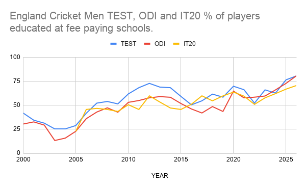

On the 31st July 2025 state educated Chris Woakes took the field in a Test against India with the rest of his teammates having attended fee paying schools. Twenty two years earlier in Sri Lanka, Mark Butcher had done something similar, only he had taken to the field with the rest of his team being state educated.

In 2003 10 England men ODI matches were played with all state educated players, a run interrupted by the selection of Rob Key as a player. Since July 2025 England have selected Test & ODI teams that contain 10 players from fee paying schools five times. The % of fee paying players has reached over 80% for both the Test & ODI team in 2026. Back in 2005 it was only 29% & 23% respectively. In 2019 we won the ODI World Cup with 7 state schooled players.

METHOD

For each format played this century an annual % of fee paying players is calculated by:

(Total of fee paying player selections) / (no of matches \* 11) \* 100

Only teams listed in cricketarchive are used (some cancelled matches are not listed but these are very few).

Fee paying schools include independent schools as well as a few grammar schools that charge fees e.g. Manchester Grammar School & Loughborough Grammar School.

Players developed overseas are included eg. KP (indy), Jofra (state)

**[Are scholarships cricket’s biggest red herring?](https://onemoresummer.co.uk/post/are-scholarships-crickets-biggest-red-herring/)**